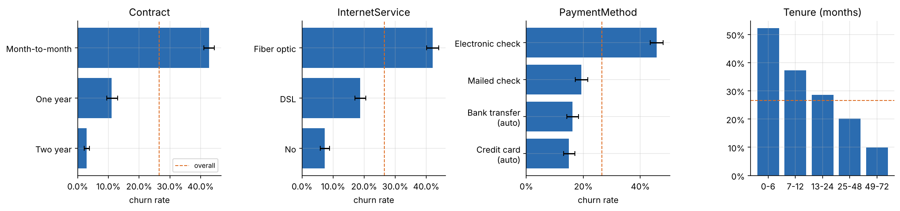
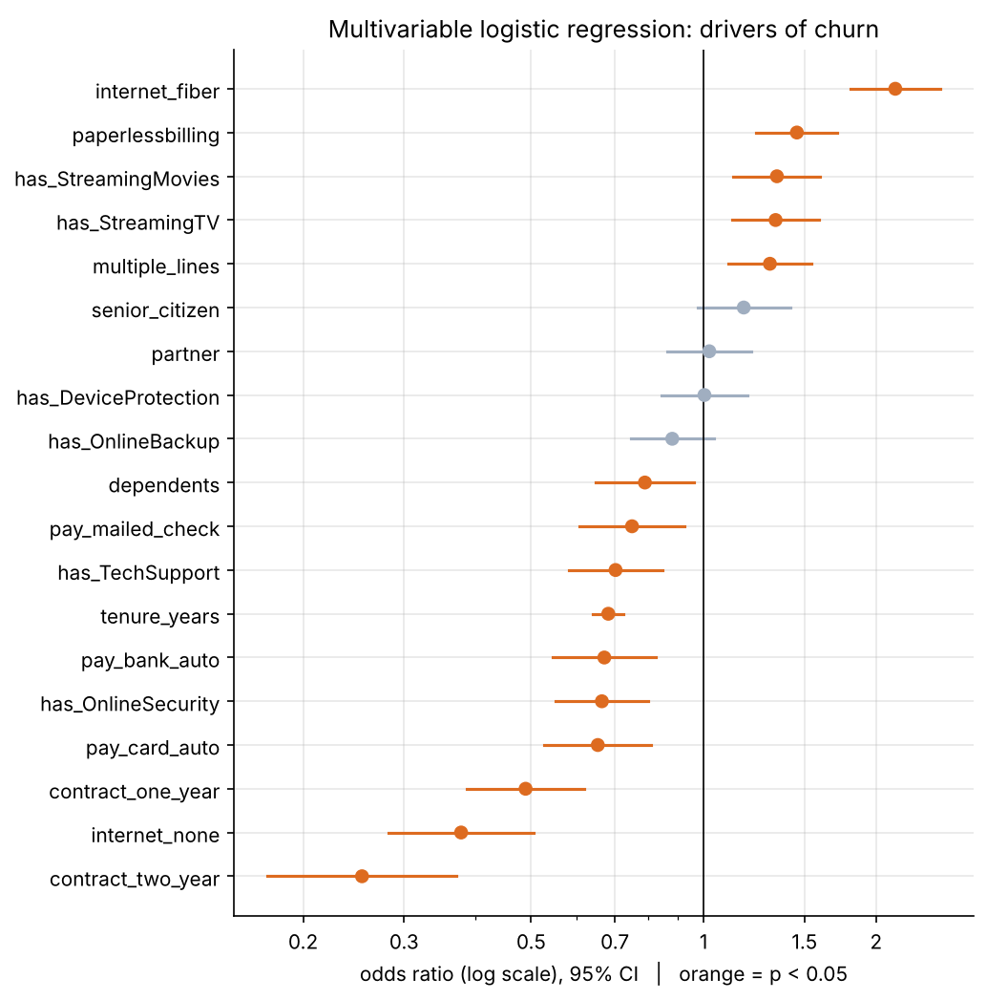
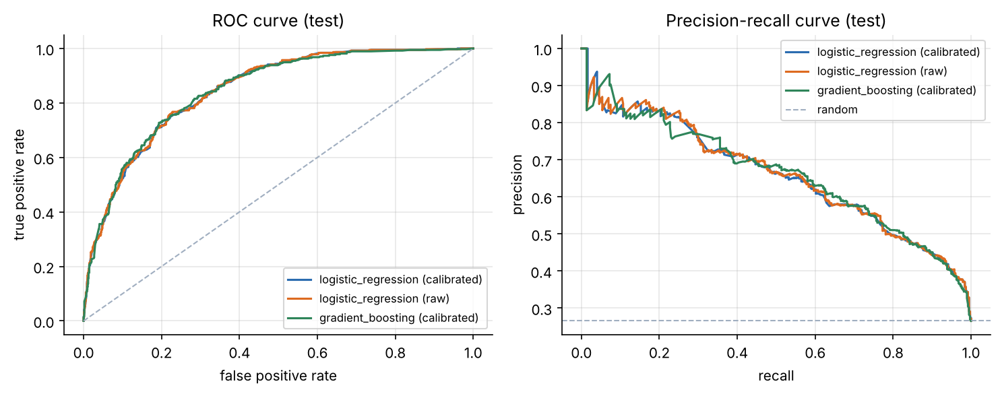
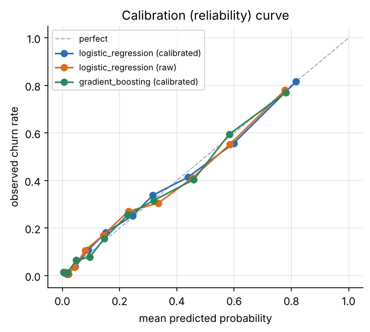
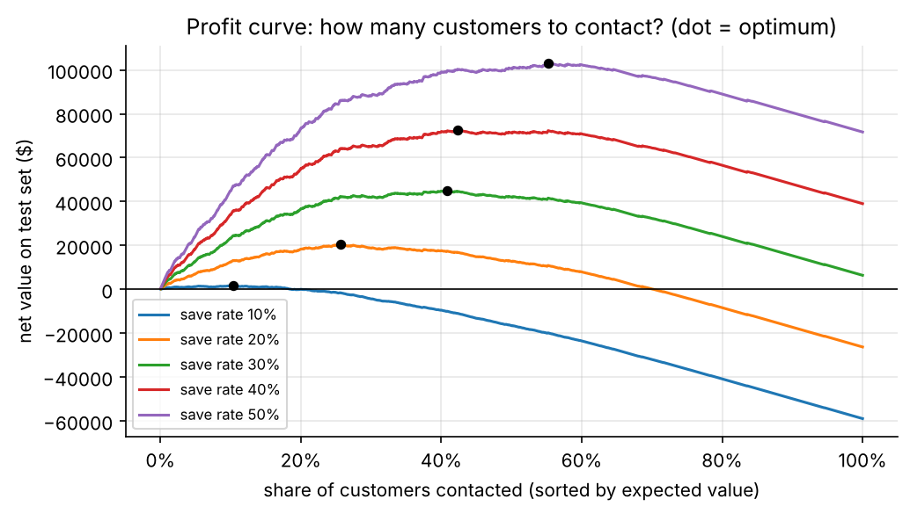
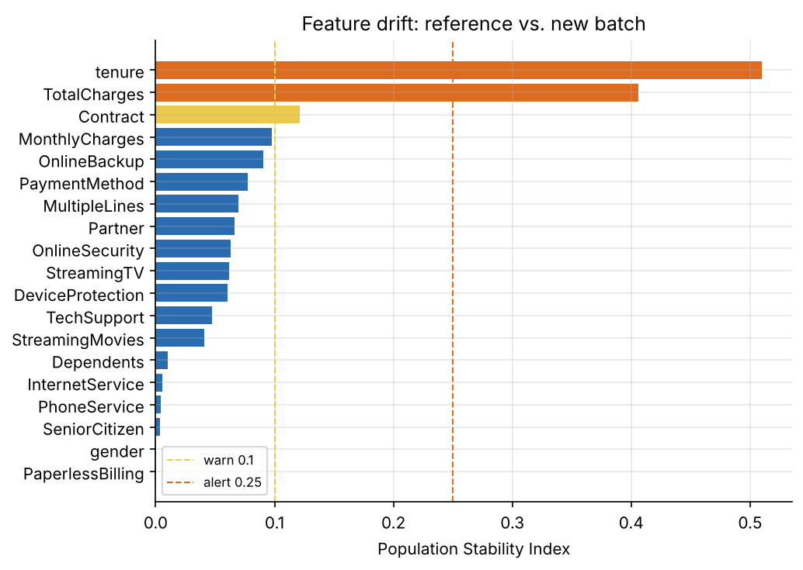

# Telco churn prediction & retention decision support


An end-to-end, reproducible churn project for a telecom operator. It covers the full
path from raw data to a business decision and a monitored production model:

**ingestion & validation → statistical analysis → model selection → calibration →
profit-based targeting → batch scoring → drift monitoring → MLflow tracking & registry → CI/CD**

Every module contains English explanations of *why* each statistical method is used,
its assumptions, and how to read the result.

---

## Business question

> Which customers should receive a retention offer next month, and how much is that worth?

Churn prediction alone does not answer this. A model ranks customers by risk. The
company also needs to know **whom to contact**, given that offers cost money and not
every at-risk customer can be saved.

## Key results (held-out test set, 1 409 customers)

| | Result |
|---|---|
| **Main churn drivers** | Month-to-month contract, short tenure, fiber-optic internet, electronic-check payment, no security/tech-support add-ons |
| **Model** | Calibrated L2 logistic regression, test **ROC-AUC 0.845** (95% CI 0.824–0.865), **ECE 0.019** |
| **Gradient boosting vs. logistic regression** | Not significantly different (paired bootstrap ΔAUC = −0.001, p = 0.81), so the simpler, interpretable model was kept |
| **Top decile lift** | **2.9×**: the 10% highest-scored customers churn at 77% vs. 27% on average |
| **Recommended policy** | Expected-value rule: contact the **39%** of customers with positive expected value. This reaches 73% of churners |
| **Value vs. alternatives** | **+$44.3k** on the test set vs. +$35.5k (p > 0.5 rule), +$34.0k (top 20%), +$6.4k (contact everyone) |
| **Monitoring** | No false alarm on an unchanged batch. A simulated acquisition-campaign shift is caught (tenure PSI 0.51 → ALERT) |

Monetary figures depend on the assumptions in [`configs/config.yaml`](configs/config.yaml)
(12-month customer value, $65 offer + contact cost, 30% save rate). See the sensitivity
analysis below.

---

## 1. Statistical analysis: why do customers churn?

Full report: [`reports/statistical_analysis.md`](reports/statistical_analysis.md). It is computed on
the training split only, so the test set stays untouched.



**Methods**
- **Churn rate with Wilson confidence intervals.** Better coverage than the normal approximation for small groups.
- **Chi-square tests of independence** for the categorical features, with **bias-corrected Cramér's V** as effect size. The expected cell counts are checked (all ≥ 148).
- **Mann–Whitney U** for the numeric features. Tenure and charges are skewed and bimodal, so a t-test's normality assumption does not hold. The effect size is the **rank-biserial correlation**.
- **Benjamini–Hochberg FDR correction** across the 19 tests.
- **Multivariable logistic regression** (statsmodels), reported as odds ratios with 95% CIs. Multicollinearity is checked with VIF.

**Findings**
- Contract type has the strongest categorical association (Cramér's V = 0.41). Month-to-month customers churn at 42.7%, two-year customers at 2.9%.
- Tenure has the strongest overall effect (rank-biserial r = −0.47). The median tenure is 10 months for churners and 38 months for those who stay.
- Gender and phone service are **not** associated with churn after FDR correction.
- Holding everything else constant: fiber optic doubles the churn odds (OR 2.16, CI 1.81–2.59). A two-year contract cuts them by 75% (OR 0.25). Each year of tenure lowers them by 32% (OR 0.68).



> **A methodological note worth reading.** The first model version included
> `MonthlyCharges` and got VIF ≈ 33 with an odds ratio *below* 1 ("higher bills reduce churn").
> The bill is almost a deterministic sum of the subscribed services, so its coefficient was
> not interpretable. It was removed from the *inference* model (max VIF now 2.8) but kept in
> the *predictive* models, because multicollinearity harms interpretation, not prediction.

## 2. Predictive model

Full report: [`reports/model_report.md`](reports/model_report.md)

**Setup**
- Stratified 80/20 train/test split. The test set is used once, at the end.
- **Nested cross-validation.** An inner 3-fold loop tunes the hyperparameters, and an outer 5-fold loop estimates the performance of the whole tuning procedure. This avoids the optimistic bias of tuning and scoring on the same folds.
- Candidates: a prior baseline, L2 logistic regression, and histogram gradient boosting.
- **No class re-weighting or SMOTE.** Both distort predicted probabilities, and the business decision needs true probabilities. The class imbalance is handled in the decision threshold instead.
- **Isotonic calibration** of the selected model, checked with reliability curves and the Expected Calibration Error.
- Bootstrap 95% CIs for all test metrics, and a **paired bootstrap test** for the model comparison.

| Model (nested CV, mean ± sd) | ROC-AUC | PR-AUC | Brier |
|---|---|---|---|
| Prior baseline | 0.500 | 0.265 | 0.1949 |
| Logistic regression | **0.850 ± 0.013** | **0.671 ± 0.016** | **0.1333** |
| Gradient boosting | 0.848 ± 0.013 | 0.662 ± 0.027 | 0.1346 |

<p float="left">
  
  
</p>

The logistic regression is already well calibrated (its loss function is the log-likelihood),
so isotonic calibration changes little here. The step stays in the pipeline as a safeguard
for when a less calibrated model wins in a future retrain.

## 3. From probabilities to a decision

Expected value of sending an offer to customer *i*:

$$EV_i = p_i \cdot s \cdot CLV_i - c$$

where *p* is the calibrated churn probability, *s* the save rate, *CLV* = 12 × monthly charges,
and *c* the offer + contact cost. Contact if EV > 0, i.e. if *p<sub>i</sub>* > *c* / (*s* · *CLV<sub>i</sub>*).
The threshold is therefore **customer-specific**: high-value customers are worth contacting
at lower risk levels. This is why no single cut-off such as 0.5 is optimal.

| Policy (test set) | Contacted | Churners reached | Net value |
|---|---|---|---|
| Contact nobody | 0% | 0% | $0 |
| Contact everybody | 100% | 100% | $6.4k |
| p > 0.5 | 22% | 53% | $35.5k |
| Top 20% by risk | 20% | 50% | $34.0k |
| **EV > 0 (recommended)** | **39%** | **73%** | **$44.3k** |



**Sensitivity analysis.** The save rate is an assumption, so the result is reported over a
range. At a 10% save rate the campaign barely breaks even and contacting everyone loses
$59k. At 50% it is worth $100k. **The save rate should be measured with a randomised A/B
test (offer vs. control) before scaling the campaign.**

## 4. Monitoring

Full report: [`reports/monitoring_report.md`](reports/monitoring_report.md)

Each scoring batch is compared with the training reference:
- **Population Stability Index (PSI)** per feature and for the predicted probabilities. Below 0.10 is OK, 0.10–0.25 is WARN, above 0.25 is ALERT.
- **Kolmogorov–Smirnov / chi-square tests** as supporting evidence. With large batches these are significant for trivial shifts, so the decisions are based on PSI, which is an effect size.
- **Performance and calibration checks** when the delayed churn labels arrive.

| Batch | Status | Flagged | Predicted churn | AUC |
|---|---|---|---|---|
| A: unchanged test set | OK | none | 26.7% | 0.845 |
| B: simulated acquisition campaign (4× more first-year customers) | **ALERT** | tenure (PSI 0.51), TotalCharges (0.41), Contract (0.12) | 36.8% (observed 35.3%) | 0.809 |

The drift is simulated by **resampling real rows**, not by editing feature values. This keeps
P(churn | features) intact, so the performance check on the drifted batch is valid. The model
stays calibrated under the shift (predicted 36.8% vs. observed 35.3%). AUC drops because the
new population covers a narrower tenure range, so ranking within it is harder.



## 5. MLOps

- **Configuration-driven.** All parameters live in `configs/config.yaml`.
- **Data contract.** `validate()` rejects missing columns, unknown categories and negative values before any model runs.
- **sklearn Pipelines.** The identical preprocessing is used in CV, training and scoring, which prevents leakage. Unseen categories do not crash scoring.
- **MLflow.** Each run logs its parameters, metrics and reports, and the model is registered as `telco-churn-classifier`.
- **GitHub Actions** ([`ci.yml`](.github/workflows/ci.yml)):
  - lint (ruff) and unit tests on Python 3.11 and 3.12;
  - the full pipeline on the real data;
  - a **quality gate** that fails the build if AUC < 0.80, ECE > 0.05, or monitoring raises a false alarm;
  - a batch-scoring smoke test;
  - uploaded artefacts;
  - a **weekly scheduled retrain**.
- **19 unit tests** on synthetic data. They check the statistics, for example that Cramér's V is ≈ 0 under independence and that the ECE is ≈ 0 for a perfectly calibrated model, as well as the decision maths and the drift detection.

## Run it

```bash
git clone https://github.com/obuczkipp/telco-churn-mlops.git
cd telco-churn-mlops
make install        # pip install -e ".[tracking,dev]"
make all            # downloads data, runs stats → train → decision → monitoring → MLflow (~1 min)
make test
make mlflow-ui      # browse runs at http://127.0.0.1:5000

# score new customers (CSV with the same columns, Churn not required)
python -m churn.pipeline score --input new_customers.csv --output scored.csv
```

`scored.csv` contains, for each customer, the churn probability, the expected value of an offer, and the recommended action.

## Project structure

```
configs/config.yaml        all parameters (data, CV, business assumptions, monitoring thresholds)
src/churn/
  data.py                  download, cleaning, schema validation, stratified split
  stats_analysis.py        hypothesis tests, effect sizes, FDR, logistic regression, VIF
  features.py              domain features + preprocessing pipeline
  train.py                 nested CV, model selection, calibration, test evaluation
  metrics.py               ECE, bootstrap CIs, paired bootstrap comparison
  decision.py              expected-value targeting, policy comparison, lift, sensitivity
  monitoring.py            PSI, KS / chi-square drift tests, drift simulation
  plots.py                 figures
  pipeline.py              CLI entry point, reports, MLflow tracking
tests/                     unit tests (offline, synthetic data)
reports/                   generated reports and figures (committed for reading on GitHub)
```

## Data

[Telco Customer Churn](https://www.kaggle.com/datasets/blastchar/telco-customer-churn) (Kaggle, IBM sample
data): 7 043 customers, 21 columns, 26.5% churn. The pipeline downloads it from
[IBM's GitHub](https://github.com/IBM/telco-customer-churn-on-icp4d), the same data as on Kaggle, so CI
needs no Kaggle credentials. Eleven new customers (tenure = 0) have blank `TotalCharges`. These are
imputed as 0, because the value is structurally zero rather than missing at random.

## Limitations & next steps

- **No time dimension.** The data is a snapshot, so a true out-of-time validation is not possible. With real data, train on months 1..t and validate on month t+1.
- **No treatment data, so no uplift.** A high-risk customer may not respond to any offer. The next step is a randomised campaign with a control group, then an **uplift model** (T-learner / X-learner) that targets the *persuadable* customers, not just the risky ones.
- **The save rate is assumed.** It should be measured with an A/B test, with a sample size from a power analysis.
- **Customer value is simplified.** Margins and the contract end date are ignored.
